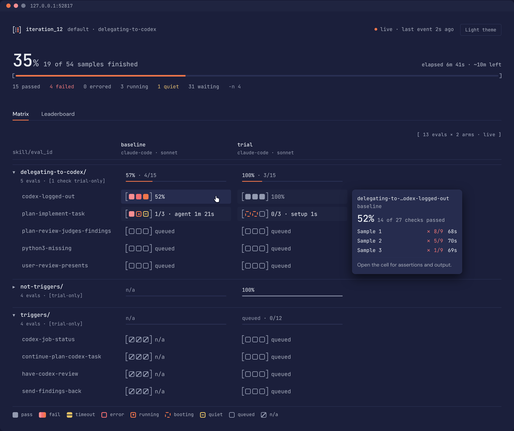
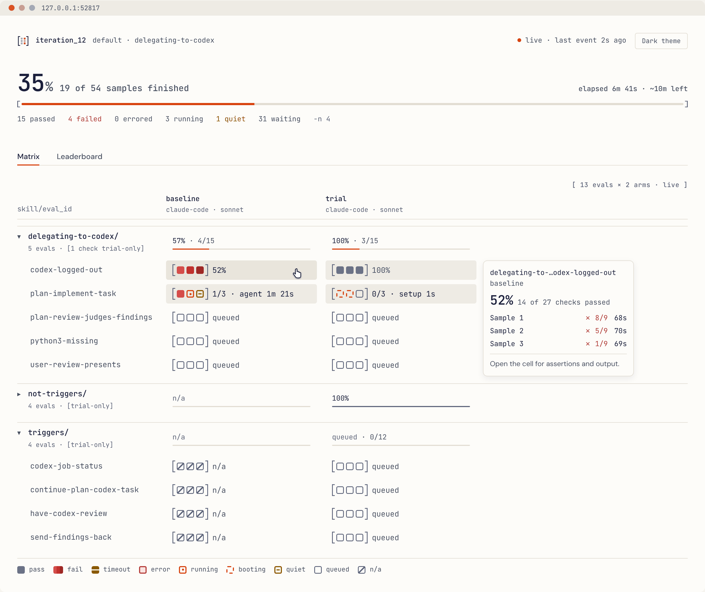
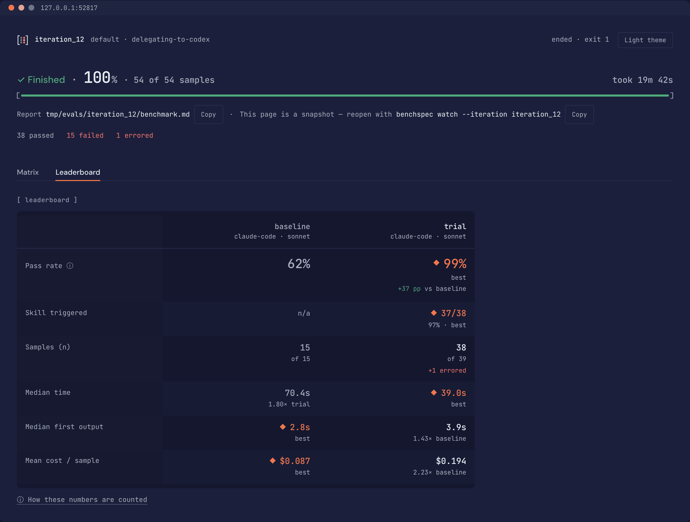
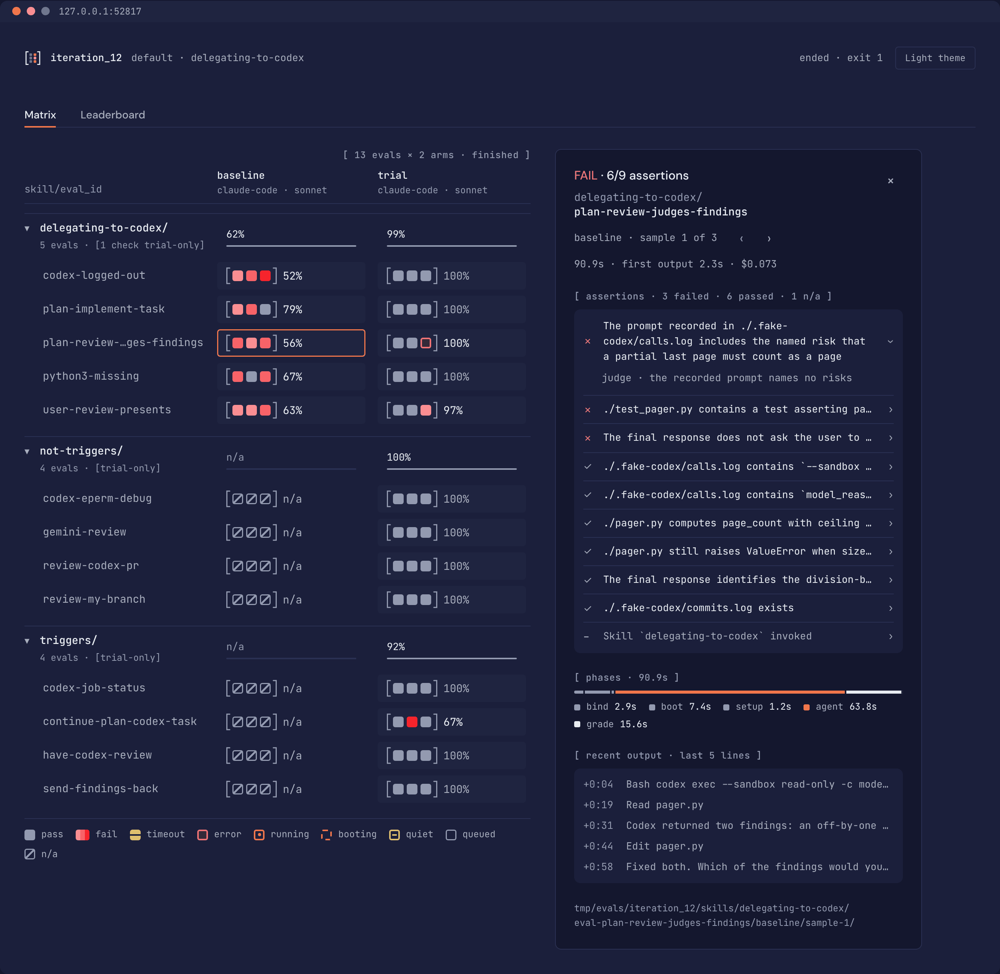
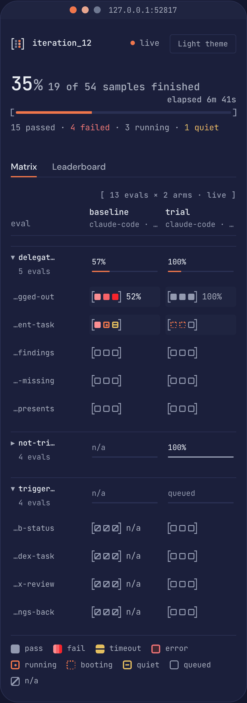
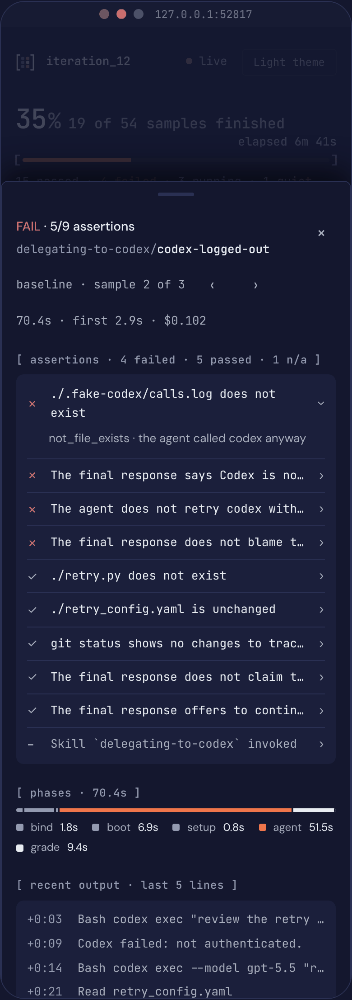
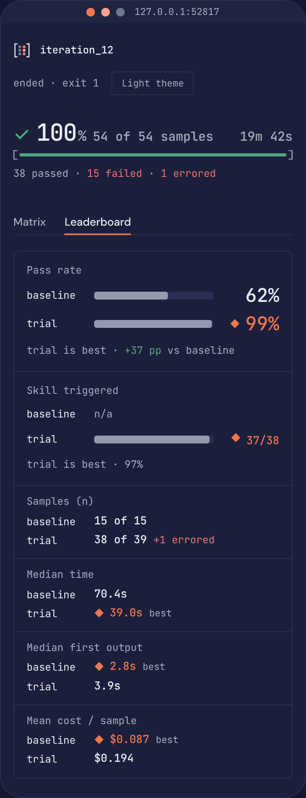

# `benchspec watch` mockups

The approved frames for `benchspec watch`
([#180](https://github.com/theycallmeswift/benchspec/issues/180)). They are
static pictures. Where a frame disagrees with [the design system](../README.md)
or #180, the design system and #180 win.

Frames A to D2 show one `delegating-to-codex` run: 13 evals × 2 arms × 3
samples. Trigger evals run only on trial, so they are n/a on baseline.

| Frame | Shows | File |
| --- | --- | --- |
| A dark | Mid-run desktop: 19 of 54 samples, a quiet sample, all three fail steps, hover card on `codex-logged-out` × baseline | [`a-dark.png`](assets/a-dark.png) |
| A light | Frame A in the light theme | [`a-light.png`](assets/a-light.png) |
| B | Finished, Leaderboard tab: exit 1, one trial boot failure | [`b.png`](assets/b.png) |
| C | Drawer on `plan-review-judges-findings` × baseline, sample 1 of 3 | [`c.png`](assets/c.png) |
| D | Phone, 390px, two arms, matrix | [`d.png`](assets/d.png) |
| D with the sheet | Frame D with the drawer open as a bottom sheet | [`d-sheet.png`](assets/d-sheet.png) |
| D2 | Phone leaderboard | [`d2.png`](assets/d2.png) |

Frames D3 (phone, four arms, pinned id column) and E (four arms finished, a
`-k` hole, an all-errored cell, a timeout) aren't here: they show a private
eval suite. #180 describes both.

