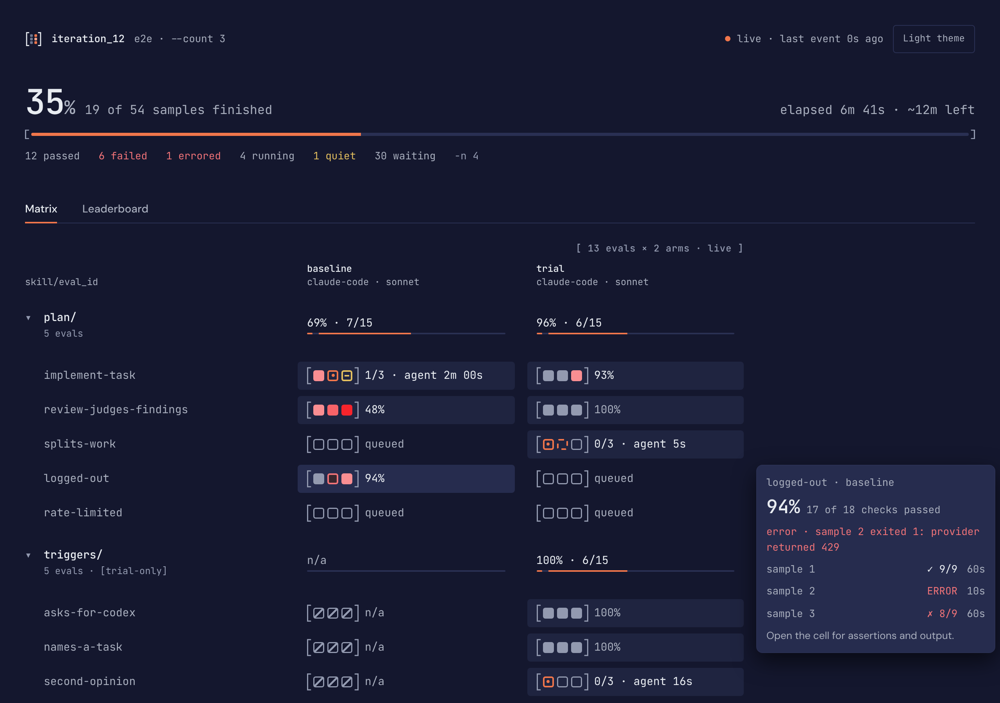
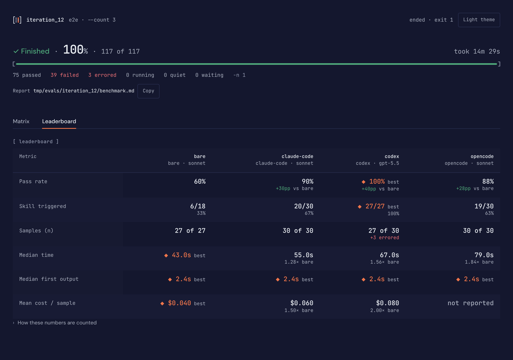

# Watching a run

`benchspec watch` serves a local page that follows a run's
[event stream](../results.md#the-event-stream): how far the run is, what every
sample is doing, and how the arms compare so far. The terminal stays the
default; the page is opt-in. Visuals follow the
[design system](../design/README.md).



## Two ways in

```bash
benchspec run --watch --workers 6 -- --count 3   # this run, while it runs
benchspec watch                                  # the newest iteration
benchspec watch --iteration iteration_05 --port 8765
```

- **`run --watch`** prints `Watching: http://127.0.0.1:<port>/` and serves until
  the run ends. It never outlives the run, so it cannot hang a CI job. To name
  its iteration up front it passes pytest `--benchspec-iteration`.
- **`watch`** replays an iteration from its first event, so a finished run
  shows its final state at once, and serves until Ctrl-C. Use it to keep a
  page open after `run --watch` exits, or to look at an older run.

Flags and exit codes: [`configuration.md`](../configuration.md#benchspec-watch).

## Nothing leaves your machine

Deltas carry agent output, so the page is reachable only from this computer:

- The server binds `127.0.0.1` and has no `--host` flag. To watch a remote run,
  forward the port: `ssh -L 8765:127.0.0.1:8765 host`.
- A request whose `Host` header is not `127.0.0.1:<port>` or
  `localhost:<port>` gets `403`, which blocks DNS rebinding.
- Every response sets `Content-Security-Policy: default-src 'self'` and
  `Cache-Control: no-store`. The page loads no script, style or font from
  another origin; the fonts ship in the package.
- It reads only the iteration's `events-*.jsonl` and finished samples'
  `grading.json`, and accepts only `GET`.

## What the page shows

- **Counter.** Percent of samples finished, `N of M samples finished`, elapsed
  time and an estimate of what is left, then a tally: passed, failed, errored,
  running, quiet, waiting, and the worker count.
- **Matrix.** One row per eval, grouped by its folder, one column per arm, one
  box per sample. Hover or focus a cell for its samples; click it for one
  sample's assertions, phases, last five output lines and artifact path. A
  group that finishes cleanly collapses while the run is live.
- **Leaderboard.** Arms as columns: pass rate, skill triggered, samples, median
  time, median first output and mean cost. The page moves here when the run
  ends unless you already picked a tab.


| Box | Sample state |
| --- | --- |
| queued | Planned, not started. |
| booting | Started; building a snapshot, binding, booting or in `setup.sh`. |
| running | The agent is working, or the sample is being graded. |
| quiet | The agent has emitted nothing for 30 seconds. |
| pass, fail | Graded. A fail is darker the fewer checks passed. |
| timeout | Hit its cap and was graded as it stood. |
| error | An infra failure; never graded. |
| n/a | Every assertion is scoped off this arm. |
| unfinished | Never closed before the run ended; drawn as queued. |

Once the run ends, a sample that never closed (its fixtures failed, or its
worker was killed) reads `unfinished`, and the run as
`Run stopped · N of M finished`.

A run killed before it wrote `run.end` goes **stale**: the top bar reads
`stale · no events for …` (`stale` on a phone) and the clocks stop at the last
event. It turns stale once the stream is silent for a minute longer than the
longest arm's cell `timeout`, and returns to live if events resume.

## How it counts

- **The unit is a sample.** `M` is every planned sample that grades something;
  `N` is those that finished (pass, fail, timeout or error). n/a samples count
  nowhere.
- **Tally.** A timeout counts as failed; the buckets sum to `M`. After the run
  ends, samples that never closed count as unfinished.
- **A cell's rate** counts every check its graded samples ran. Errored samples
  add none; a cell whose every sample errored shows `—`.
- **The leaderboard pass rate** pools only checks every arm runs, exactly as
  [`benchmark.md`](../results.md#benchmarkmd-section-by-section) does, so it
  can differ from the cell rates. Its other rows cover graded samples.
- **Time left.** Each unfinished sample is expected to take the mean time of
  the finished ones, less the time it has run. Their sum is divided by the
  worker count, or by the samples left when fewer. Nothing shows until a
  sample finishes, or while every running sample is past the mean.
- **Cost** is what the harness reported, never estimated: `not reported`
  otherwise.

`benchmark.md` stays the record: it holds the final figures and their noise
bands.


