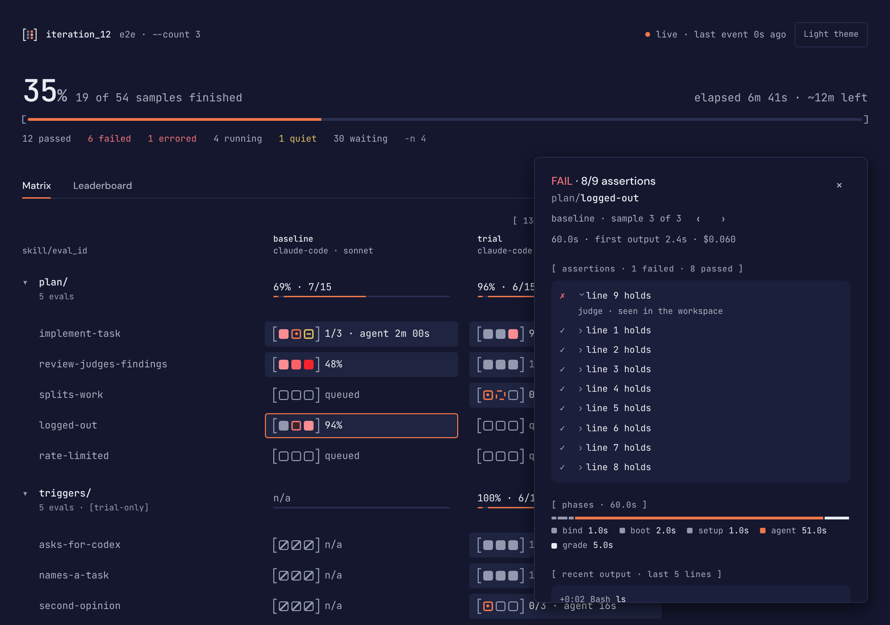

# Watching a run

`benchspec watch` serves a local page that follows a run's
[event stream](../results.md#the-event-stream): how far the run is, what every
sample is doing, and how the arms compare so far. The terminal stays the
default; the page is opt-in. Visuals follow the
[design system](../design/README.md).


## Two ways in

```bash
benchspec run --watch --workers 6 -- --count 3   # this run, while it runs
benchspec watch                                  # the newest iteration
benchspec watch --iteration iteration_05 --port 8765
```

- **`run --watch`** prints `Watching: http://127.0.0.1:<port>/` and serves until
  the run ends. It never outlives the run, so it cannot hang a CI job. To name
  its iteration up front it passes pytest `--benchspec-iteration`.
- **`watch`** replays an iteration from its first event, so a finished run
  shows its final state at once, and serves until Ctrl-C. Use it to keep a
  page open after `run --watch` exits, or to look at an older run.

Flags and exit codes: [`configuration.md`](../configuration.md#benchspec-watch).

## Nothing leaves your machine

Deltas carry agent output, so the page is reachable only from this computer:

- The server binds `127.0.0.1` and has no `--host` flag. To watch a remote run,
  forward the port: `ssh -L 8765:127.0.0.1:8765 host`.
- A request whose `Host` header is not `127.0.0.1:<port>` or
  `localhost:<port>` gets `403`, which blocks DNS rebinding.
- Every response sets `Content-Security-Policy: default-src 'self'` and
  `Cache-Control: no-store`. The page loads no script, style or font from
  another origin; the fonts ship in the package.
- It reads only the iteration's `events-*.jsonl` and finished samples'
  `grading.json`, and accepts only `GET`.

## What the page shows

- **Counter.** Percent of samples finished, `N of M samples finished`, elapsed
  time and an estimate of what is left, then a tally: passed, failed, errored,
  running, quiet, waiting, and the worker count. Each tally bucket is a toggle
  that filters the matrix to the evals with a sample in it; pick several to see
  any of them, and **Clear filters** to see every eval again.
- **Sample time by phase.** Under the tally, the time every started sample
  spent in each phase (`snapshot`, `bind`, `boot`, `slot wait`, `setup`,
  `agent`, `grade`), and how many samples are in each one now, such as
  `snapshot 10m 02s · 6 now`. Samples that grade nothing count here too: they
  hold a worker all the same.
- **Matrix.** One row per eval, one column per arm, one box per sample. Each
  arm's head carries its pass rate, and on other arms its delta from the
  baseline (`97% (+35pp)`), as the leaderboard shows them. Evals are grouped by
  their folder, skill first (`to-spec/triggers/`); a run of one skill names it
  once, in the top bar. Groups start collapsed (a run with one group starts
  open): a group's row gives each arm's rate, `done/total` and how its samples
  stand (`3 passed · 1 failed · 2 running`). Hover or focus a cell for its
  samples; the card sits beside the row when the window leaves room, else under
  the cell. Click a cell for one sample: what it is doing or waiting on, its
  assertions (the planned lines until it is graded), phases, last five output
  lines and artifact path.
- **Leaderboard.** Arms as columns: pass rate, skill triggered, samples, median
  time, median first output and mean cost. The page moves here when the run
  ends unless you already picked a tab.



| Box | Sample state |
| --- | --- |
| queued | Planned, not started. |
| booting | Started; building a snapshot, binding, booting, waiting for a sandbox slot or in `setup.sh`. Its dot pulses. |
| running | The agent is working, or the sample is being graded. Its dot pulses. |
| quiet | The agent has emitted nothing for 30 seconds. |
| pass, fail | Graded. A fail is darker the fewer checks passed. |
| timeout | Hit its cap and was graded as it stood. |
| error | An infra failure; never graded. |
| n/a | Every assertion is scoped off this arm. While such a sample runs, its box shows booting or running and its cell reads `n/a · snapshot 1m 30s`. |
| unfinished | Never closed before the run ended; drawn as queued. |

A finished run reads `✓ Finished` in green when it exited 0, failed samples
included. Otherwise it reads `✗ Finished` in red with the reason, such as
`exit 1 · 1 errored`.

Once the run ends, a sample that never closed (its fixtures failed, or its
worker was killed) reads `unfinished`, and the run as
`Run stopped · N of M finished`.

A run killed before it wrote `run.end` goes **stale**: the top bar reads
`stale · no events for …` (`stale` on a phone) and the clocks stop at the last
event. It turns stale once the stream is silent for a minute longer than the
longest arm's cell `timeout`, and returns to live if events resume.

## How it counts

- **The unit is a sample.** `M` is every planned sample that grades something;
  `N` is those that finished (pass, fail, timeout or error). n/a samples count
  nowhere.
- **Tally.** A timeout counts as failed; the buckets sum to `M`. After the run
  ends, samples that never closed count as unfinished.
- **Rates match `benchmark.md`.** A cell's rate, a group's and an arm's count
  only the checks every arm of the eval runs, averaged per sample, exactly as
  [`benchmark.md`](../results.md#benchmarkmd-section-by-section) does, so a
  rate the report shows reads the same on the page. A check scoped to
  some arms is left out of the rate; the hover card counts it on its own line
  (`+ 1 of 1 scoped, outside the rate`). An eval whose every check is scoped,
  such as a trigger eval, is rated on those checks instead (`1 of 1 scoped
  checks passed`), where `benchmark.md` shows `—`; a group's rate includes
  such evals, an arm's does not. Errored samples add nothing; a cell whose
  every sample errored shows `—`. The leaderboard's other rows cover graded
  samples.
- **Before `bind`** a sample is in `snapshot`: building the sandbox snapshot,
  or waiting on another worker's build. A boot the sandbox backend refuses for
  capacity (`cell.wait`) is in `slot wait` until its next phase: it reads as
  booting, never as an error.
- **Percentages** read as `benchmark.md`'s do: `100%` only when every check
  passed, `0%` only when none did.
- **Time left.** Waiting samples are played forward, in plan order, onto the
  worker that frees first. A sample is expected to take its arm's mean, or
  every arm's until one of its own finishes. Time before the agent starts is
  counted apart, at its median, so a snapshot build is not work. The estimate
  holds still while a sample overruns: held by a snapshot build, or past its
  arm's mean. Nothing shows until a sample finishes, or once nothing is queued
  and every running sample has outrun its arm's mean.
- **Cost** is what the harness reported, never estimated: `not reported`
  otherwise.

`benchmark.md` stays the record: it holds the final figures and their noise
bands.


